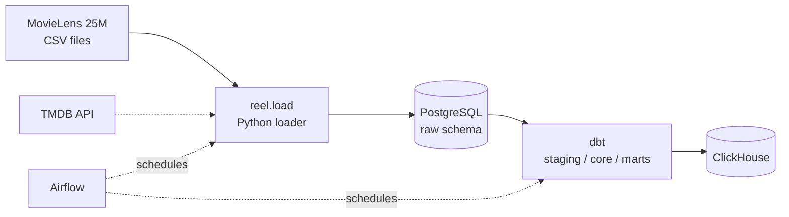

# reel-data-platform

Learning data platform built step by step: MovieLens ratings and TMDB metadata
are loaded into PostgreSQL, orchestrated by Airflow, modeled with dbt and served
from ClickHouse. Every stage is a separate version (see Status below).

## Architecture



Solid arrows are implemented (v0.1); dashed arrows are planned.

## Project structure

- `src/reel/` — Python package: MovieLens/TMDB loaders (`reel.load`), database helpers (`reel.db`)
- `sql/raw/` — DDL for the raw schema
- `scripts/` — one-off exploration scripts
- `tests/` — pytest tests
- `docker/` — Dockerfile and Compose files (Airflow, ClickHouse)
- `dags/` — Airflow DAGs
- `dbt/` — dbt project (staging -> core -> marts)

## Getting started

Requirements: Python 3.12, PostgreSQL 17 (native, no Docker needed for v0.1).

```bash
git clone https://github.com/8Edward/reel-data-platform.git
cd reel-data-platform
py -3.12 -m venv .venv
source .venv/Scripts/activate      # Git Bash on Windows
pip install -e .
```

1. Download [MovieLens 25M](https://grouplens.org/datasets/movielens/25m/) and unzip it anywhere.
2. Create a database (e.g. `reel`) in PostgreSQL.
3. Copy `.env.example` to `.env` and fill in `PG_*` and `MOVIELENS_DIR` (the folder that contains `ratings.csv`).
4. Run the loader from the repository root:

```bash
python -m reel.load movielens
```

The loader creates the `raw` schema and the `raw.ratings` table if they do not
exist, truncates the table and loads all 25,000,095 rows in one transaction
(about 2–3 minutes on a laptop). Progress and totals are written to the log.

## Status

- **v0.1 (done):** MovieLens ratings loader as a package, CLI entry point, configuration via `.env`, logging.
- **v0.2 (next):** Airflow in Docker Compose, scheduled MovieLens load, TMDB enrichment.
- **v0.3:** dbt models (staging, core star schema, marts) and tests.
- Later: ClickHouse, data quality checks (`dq-checks`), CI, cloud deployment.

## Data sources

- [MovieLens 25M](https://grouplens.org/datasets/movielens/25m/) by GroupLens Research, University of Minnesota. Used for non-commercial educational purposes.
- F. Maxwell Harper and Joseph A. Konstan. 2015. The MovieLens Datasets: History and Context. ACM Transactions on Interactive Intelligent Systems (TiiS) 5, 4: 19:1–19:19. https://doi.org/10.1145/2827872
- [TMDB](https://www.themoviedb.org/): This product uses the TMDB API but is not endorsed or certified by TMDB.
